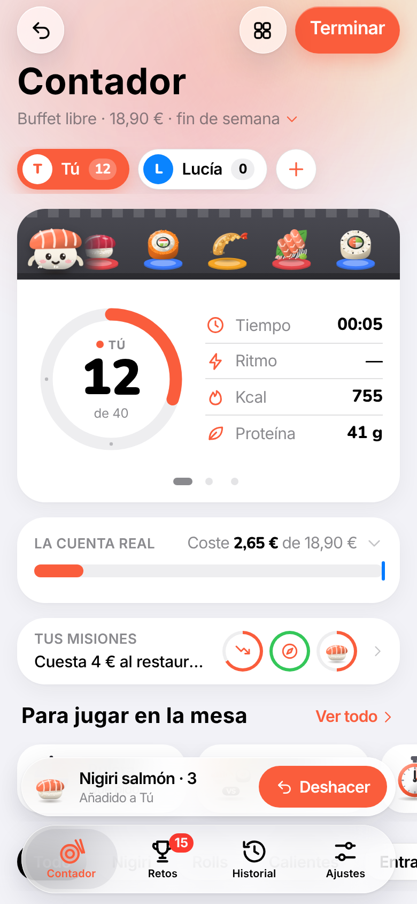
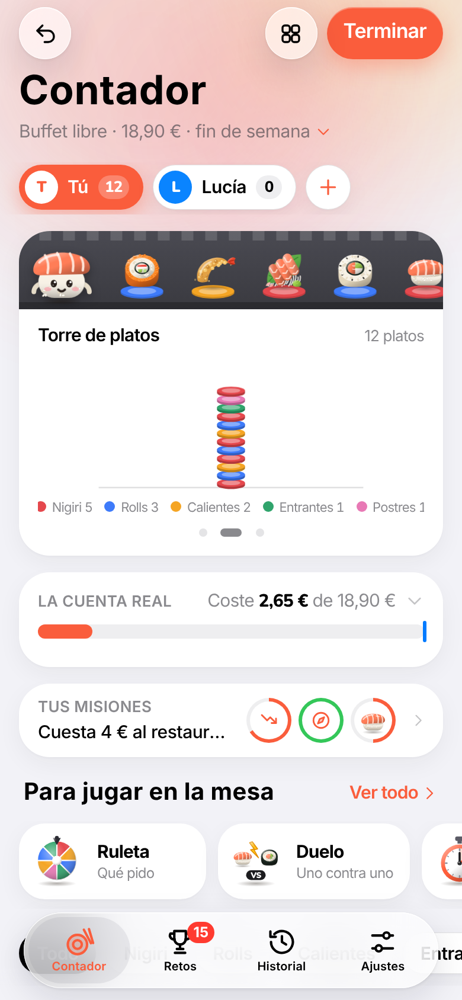
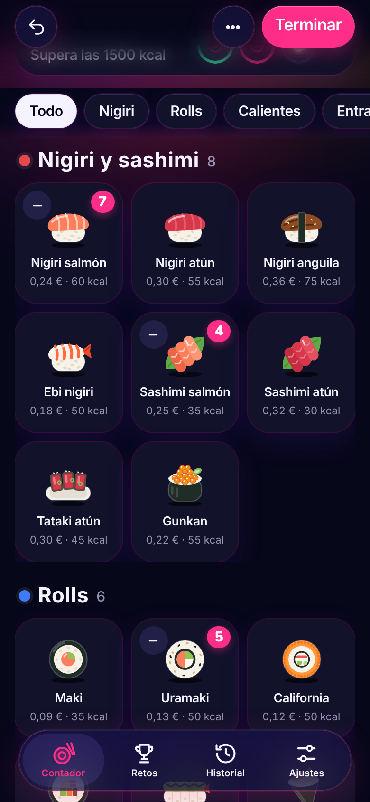

# Contador de Sushi

Web app con aspecto de iOS para llevar la cuenta de lo que comes en un buffet de sushi. Se instala en el iPhone como una app más, funciona sin conexión y no necesita cuenta.

<p align="center">
  
  
  
  
</p>

## Instalar en el iPhone

1. Abre **https://zyro0-z.github.io/Sushi-Counter/** en Safari.
2. Pulsa **Compartir › Añadir a pantalla de inicio**.

## Qué hace

**Contar**
- 31 piezas ilustradas con luz, sombra y textura (granos de arroz, sésamo, huevas…), sobre un plato del color de su categoría, como en los kaiten. También piezas personalizadas con plantilla y color.
- Toca para sumar, desliza a la derecha para sumar varias, a la izquierda para quitar y mantén pulsado para el menú.
- Deshacer en un toque y registro con hora, en el que deslizas para borrar.
- Cinta kaiten animada, torre de platos con los colores de cada categoría y gráfica de ritmo.
- Shari, la mascota: reacciona a tu ritmo, se duerme si paras y te da ideas.

**La carta del restaurante**
- Busca el restaurante por nombre o cerca de ti (OpenStreetMap), lee su carta desde su web o su PDF y añade sus platos al contador, cada uno en la sección de la carta.
- Reconoce la pieza parecida (para el dibujo, el coste y las calorías) y los detalles: flambeado, crujiente, picante, con queso, con salsa, trufa…
- Si la web no tiene la carta en texto: foto de la carta, enlace o texto pegado. También lee el precio del buffet si aparece.
- Un «nigiri de salmón flambeado» de la carta cuenta como nigiri en los desafíos.

**El dinero**
- La cuenta real: lo que pagas, lo que cuestas en ingredientes y lo que valdría en carta.
- Varios buffets con precio de mediodía, noche y fin de semana, elegido solo según la hora.
- Escaneo de tickets: lee el total y el nombre del restaurante con una foto.

**Jugar**
- 3 misiones aleatorias por sesión, 37 desafíos, 35 logros, 15 títulos y niveles con XP.
- Duelo en directo a pantalla partida, ruleta de sushi y contrarreloj, a mano en «Para jugar en la mesa» y en el panel de juegos y herramientas.
- Cada juego explica cómo funciona en tres pasos, y hay una guía de uso para quien empieza.
- Avisos de logros compactos: si llegan varios a la vez se juntan en uno y se quitan deslizando hacia arriba. Se pueden dejar en todos, solo los importantes o ninguno.
- Mesa compartida: cada uno cuenta en su móvil y el marcador se junta en directo.
- Rachas semanales, calendario, ranking histórico de la mesa y celebraciones distintas según el logro.

**Datos y ajustes**
- Estadísticas: comparación con tu media, favoritas, mapa de calor por día y hora y nutrición.
- Alérgenos (marcar u ocultar piezas), proteínas, hidratos y grasas, y aviso de calorías.
- Temas: iOS, Tokio de noche, Madera y papel y Minimal. Ocho colores de acento.
- Accesibilidad: texto según el iPhone, contraste alto, menos animaciones, VoiceOver y teclado.
- Copia de seguridad en iCloud Drive (a través de Compartir) y exportación a Excel en CSV.

## Costes

El coste de cada pieza es una estimación de ingredientes con precios de mayorista de 2026 (salmón en filete ~15 €/kg, atún ~22 €/kg, arroz ~2 €/kg, pollo ~6 €/kg). No incluye sueldos, local ni luz. Se puede ajustar pieza a pieza.

## Limitaciones

- La mesa compartida usa el servicio público [ntfy.sh](https://ntfy.sh): solo envía nombres, colores y recuentos, y necesita internet.
- El escáner de tickets descarga [Tesseract.js](https://tesseract.projectnaptha.com/) (unos 5 MB) la primera vez.
- Safari en iPhone no permite que las webs vibren ni muestra los accesos rápidos del icono; en Android sí funcionan.
- Los datos viven en el dispositivo. Usa la copia de seguridad para no perderlos.
- En la app instalada en iPhone con iOS 26, la ventana sale más corta que la pantalla ([WebKit 301108](https://bugs.webkit.org/show_bug.cgi?id=301108)). Se corrige con un alto mínimo en `html` para que iOS dé la ventana completa.
- La carta se lee con [r.jina.ai](https://jina.ai/reader) y, si falla, con [allorigins](https://allorigins.win); los PDF se abren con [PDF.js](https://mozilla.github.io/pdf.js/). Muchas webs tienen la carta solo en foto: para esas está la cámara.

## Desarrollo

Sin dependencias ni compilación: HTML, CSS y módulos de JavaScript.

```
npm start      # servidor local en http://localhost:8080
npm test       # pruebas de la lógica con node --test
```

| Ruta | Contenido |
| --- | --- |
| `index.html` | Estructura de la página |
| `css/app.css` | Estilos y temas |
| `js/catalog.js` | Piezas, costes, alérgenos, nutrición y temas |
| `js/store.js` | Estado guardado y migraciones |
| `js/logic.js` | Cálculos, retos, logros, misiones y estadísticas |
| `js/menu.js` | Lectura de cartas: secciones, platos, detalles y precios |
| `js/art.js` | Ilustraciones de comida, de los juegos y mascota |
| `js/icons.js` | Iconos de interfaz, alérgenos y medallas |
| `js/fx.js` | Sonidos, vibración y partículas |
| `js/ui/*.js` | Pantallas y hojas |
| `sw.js` | Modo sin conexión |
| `tests/` | Pruebas |

Al publicar cambios, sube la versión de `CACHE` en `sw.js` para que los móviles descarguen la nueva.
