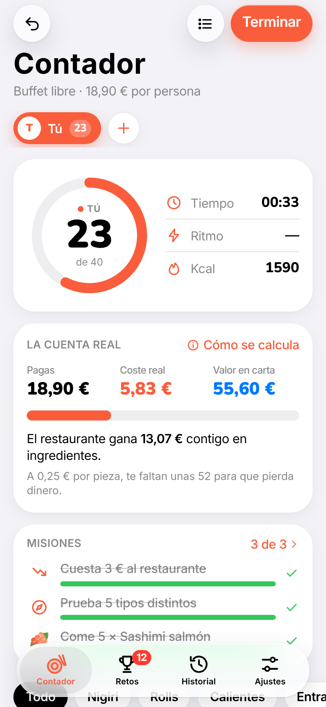
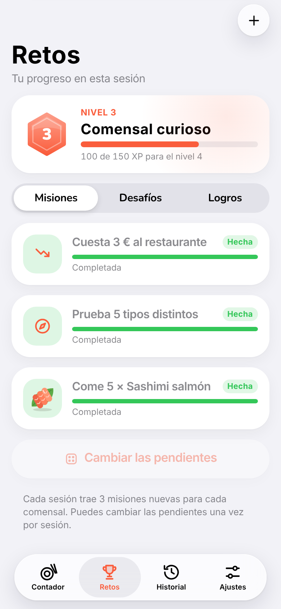
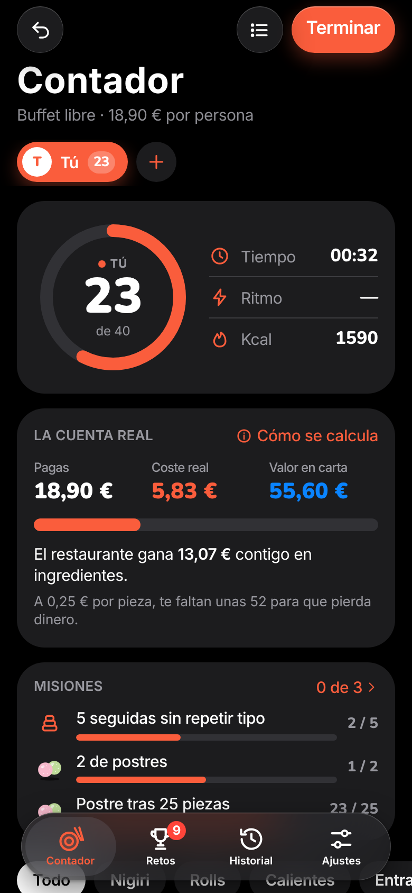

# Contador de Sushi

Web app con aspecto de iOS para llevar la cuenta de lo que comes en un buffet de sushi. Funciona sin conexión y se instala en el iPhone como una app más.

  
  
  

## Qué hace

- **30 tipos de pieza** con iconos propios: nigiris, sashimi, rolls, gyoza, pollo teriyaki, pato pekín, bao, postres y más.
- **La cuenta real**: lo que pagas, lo que le cuesta al restaurante en ingredientes y lo que valdría en carta.
- **Retos**: 3 misiones aleatorias por sesión, 37 desafíos, 27 logros y niveles con XP.
- **Varios comensales** con su propio color, duelo de la mesa y misiones para cada uno.
- **Deshacer fácil**: botón −, aviso con «Deshacer», menú al mantener pulsado y registro con deslizar para borrar.
- **Historial** con gráfica, balance acumulado e imagen para compartir cada sesión.
- **Copia de seguridad** para pasar tus datos a otro móvil.
- Mantiene la pantalla encendida durante la comida y funciona sin conexión.

## Instalar en el iPhone

1. Abre **https://zyro0-z.github.io/Sushi-Counter/** en Safari.
2. Pulsa **Compartir › Añadir a pantalla de inicio**.

Los datos se guardan solo en tu dispositivo.

## Costes

El coste de cada pieza es una estimación de ingredientes con precios de mayorista de 2026 (salmón en filete ~15 €/kg, atún ~22 €/kg, arroz ~2 €/kg). No incluye sueldos, local ni luz. Se puede ajustar pieza a pieza desde la app.

## Archivos

| Archivo | Para qué sirve |
| --- | --- |
| `index.html` | Toda la app: estilos, iconos y lógica |
| `sw.js` | Guarda la app para usarla sin conexión |
| `manifest.webmanifest` | Nombre, colores e icono al instalarla |
| `docs/` | Capturas del README |

Al publicar cambios, sube la versión de `CACHE` en `sw.js` para que los móviles descarguen la nueva.
